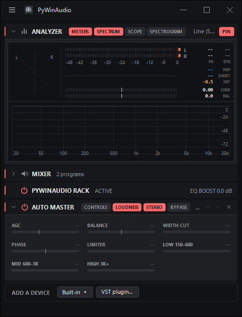

## Features

* Hardware style rack for Equalizer APO. Sound passes through the devices from top to bottom.
* Preamp, parametric EQ, graphic EQ, delay, stereo, Auto Master and VST2 plugins.
* Auto Master's Loudness and Stereo chips turn a whole stage off and back on, keeping the switches that were on.
* Analyzer with meters, spectrum, scope and spectrogram.
* Mixer for the output and app volumes.
* Every change is written to Equalizer APO's config, so the rack keeps working after the app is closed.
* Link imports the current config.txt, and Unlink puts it back.
* The rack lays out in columns when the window is wide.
* Auto, dark and light themes, with a blue or red accent.
* A tray icon with Close to tray; the analyzer pauses while hidden.

## Screenshot

## How to install

* Install Equalizer APO first.
* Download or clone a repository, install Python packages in the requirements.pip file, then execute source/main.pyw with pythonw.exe. Python 3.x is required.
* Auto Master is built from the plugin folder with Visual Studio 2022 (plugin/build.cmd, then plugin/install.ps1).
* Settings > Start menu > Create puts a shortcut in the Start menu.

## Supported platforms

* Microsoft Windows 11
